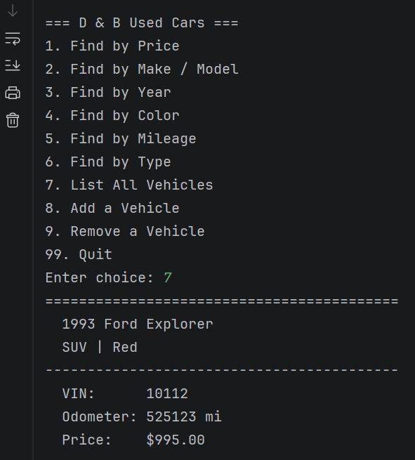

# Car Dealership

An App to manage dealership vehicle inventory, allows user to search detail of vehicles and add or remove vehicles to file.

## Features

- View all vehicles in the inventory.
- Search by price range, make and model, year range, color, mileage range, or vehicle type (car, truck, SUV).
- Add a vehicle or remove one by its VIN. The file is saved right after every add or remove.
- Display Messages for a wrong menu choice, a bad number, or a search with no matches.
- Save and load vehicles using a CSV file.

## How to run it

1. Clone the repository and open it in IntelliJ
2. Run `[Program].java`
3. A menu will appear you choose a command like 1 to select and hit enter

## Screenshots




## Interesting code

[One piece of code you're proud of, and a sentence about why.]

```java
@Override
public String toString() {
    return "==========================================\n" +
            "  " + year + " " + make + " " + model + "\n" +
            "  " + vehicleType + " | " + color + "\n" +
            "------------------------------------------\n" +
            "  VIN:      " + vin + "\n" +
            "  Odometer: " + odometer + " mi\n" +
            "  Price:    " + String.format("$%,.2f", price) + "\n" +
            "==========================================";
}
```

## Author

[Destiny Sandoval], Year Up Java Academy